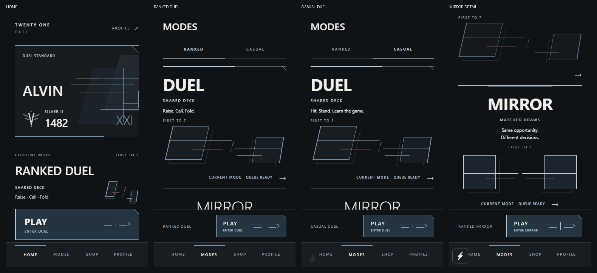
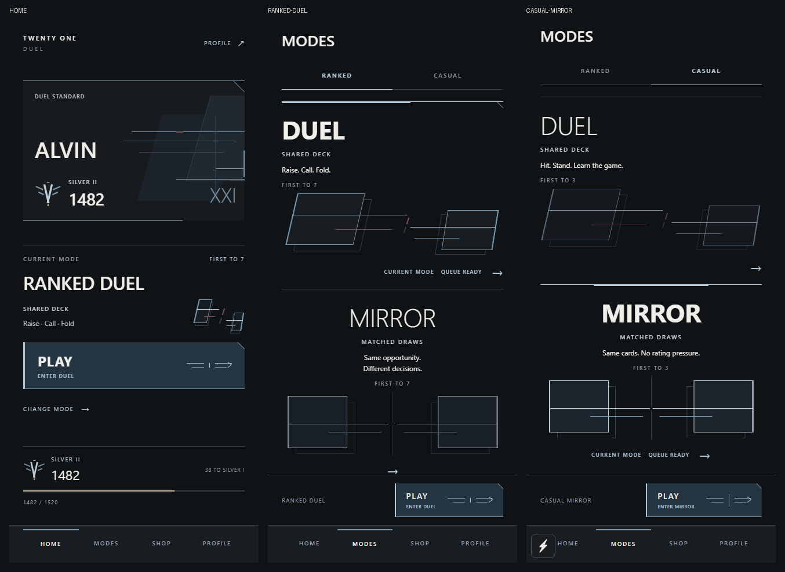

# Competitive lobby direction

The experiment is ready for screenshot review on `visual-direction`. Changes are local and uncommitted. This pass builds on the earlier lobby experiment, with competitive hierarchy as the structural reference and Twenty One Duel's existing palette and geometry as its visual identity.

## Review captures

Additional views: [selected Ranked Mirror](art-direction-v3/lobby-v3-tall-ranked-mirror.png), [small-screen rank progression](art-direction-v3/lobby-v3-small-home-progress.png), and [Play held down](art-direction-v3/lobby-v3-tall-play-pressed.png).

These are actual app screenshots in browser phone viewports, not native iOS device captures. Small screens retain scrolling; the queue action stays fixed in Modes. Development captures may include Expo's small reload indicator.

## Composition

Home now leads with an asymmetric competitive identity banner. The large player name sits above an integrated emblem, division and rating group. Cropped planes and offset strokes occupy the right side, interrupted by a small oxblood detail. A clipped upper corner and partial lower border make the banner more distinct without enclosing every section.

Current Mode has a sharper section boundary, a larger mode name, compact deck metadata and target score. Play uses a horizontal steel field, strong accent edge, clipped corner, directional convergence mark and ENTER DUEL / ENTER MIRROR caption. Existing press compression and haptics remain. Rank progression uses a compact emblem/rating group and thin progress line with next-rank information.

Modes uses large queue names and open geometric stages. Selected queues gain a partial accent frame, stronger title/artwork, CURRENT MODE and QUEUE READY labels. The ready label describes the selected local mode; matchmaking begins through Play. Duel keeps unequal sloping structures, offset lines and muted oxblood pressure. Mirror retains equal upright structures and a centered steel axis, including a centered selected-frame segment.

## Motion

- Player Card geometry and newly selected frame segments settle horizontally over 240 ms.
- Ranked/Casual's underline moves over 140 ms.
- Play's opposing signals converge on press, alongside existing press movement and haptics.
- Reduced motion disables entry animation and switches category position immediately. There are no idle loops or added gameplay timers.

## Scope

Only Home, Modes and their lobby/queue presentation changed. The experimental Player Card remains opt-in through `artDirection="lobby"`; default and compact card rendering remain unchanged. Shop, Profile, Friends, gameplay, PostMatch, Match Review, navigation, cosmetic data and palette tokens remain unchanged. No dependencies were added.

This pass adds `CompetitiveFrame.tsx` and revises Home, Modes and the lobby-only Player Card. It retains the earlier experiment's `RankEmblem`, `ModeGeometry`, `MatchEntryMark` and regression coverage. Earlier v2 review artifacts are preserved separately.

## Verification

- TypeScript and Expo lint passed.
- All 225 tests passed, including the opt-in/default-card regression.
- iOS production export passed: 1,539 modules and a 3.6 MB Hermes bundle.
- Browser checks covered Home, Ranked/Casual, Duel/Mirror, scrolled sections and both viewport sizes with zero page errors.
- With motion enabled, the category underline moved 191 px and Play entered the existing matchmaking flow.
- `git diff --check` passed.

The direction now reads more strongly as a competitive lobby through identity, queue hierarchy and directional framing. The screenshots are the review gate before extending this treatment elsewhere; native-device visual and haptic review remains outstanding.
