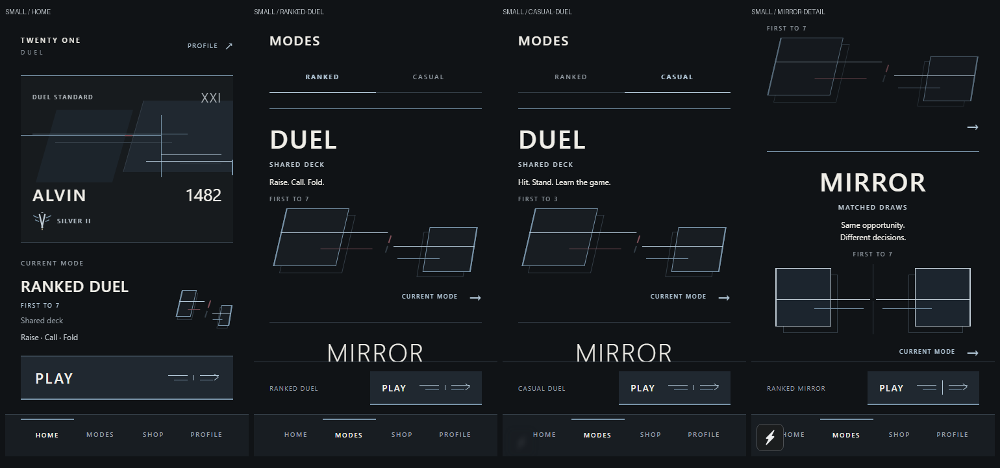
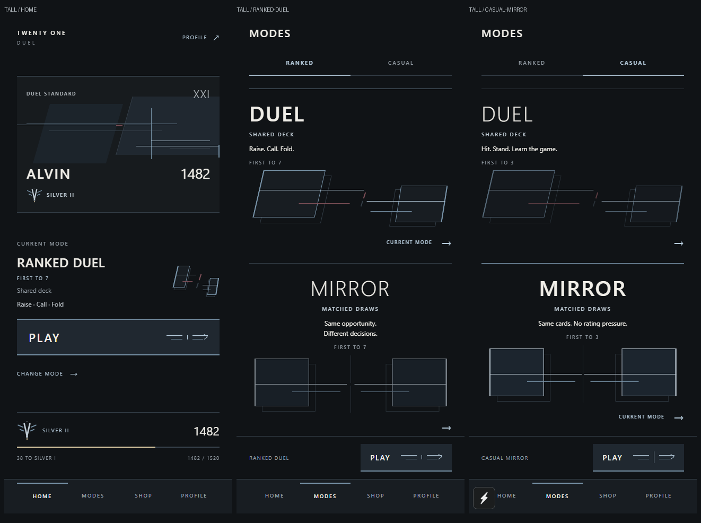

# Art direction experiment: lobby, identity and modes

Branch: `visual-direction`, created from `159c6d1` because the checkout previously had only `master`. This experiment is ready for screenshot review; it has not been committed or pushed.

## Home

The equipped Player Card anchors the lobby. Current Mode stays on the open canvas, followed by the mode name, target, deck model and decision vocabulary on separate lines. Play uses stronger typography, steel edge emphasis, a directional convergence mark and the existing press compression/haptic. The rank area pairs the emblem with SILVER II and 1482, followed by progression, remaining points and the original 1482 / 1520 threshold information. Profile shortcut, Change Mode, scroll behavior and bottom navigation remain intact.

## Player Card

The lobby-only composition replaces the oversized wordmark with a smaller XXI signature, layered opposing charcoal planes, equipped cosmetic linework, offset intersections and a slim edge treatment. Duel Standard has one small oxblood interruption. Name and rating share a baseline; division and a Silver II emblem form the supporting identity line. No gradients, shadows, glass or enclosing heavy border are used.

The new direction requires `artDirection="lobby"`, supplied only by Home. The default and compact Player Card markup/styles remain unchanged, so Shop previews, Friend Profile and matchups keep their approved appearance. Cosmetic configuration and ownership are unchanged.

## Rank emblem

`RankEmblem` explores Silver II only: two split vertical steel stems, two opposing shoulder layers, and a tiny warm base detail. SILVER II text remains visible. The independently addressable parts can later reveal progressively. Other divisions use the existing RankMark; no rank thresholds or progression logic changed.

## Duel

Unequal, sloped card-proportioned structures push toward an interrupted collision axis. Rear outlines and stepped steel signals add depth. A single oxblood signal supplies pressure. Selection increases line strength and moves the structures slightly inward, alongside the explicit CURRENT MODE label and stronger title weight.

## Mirror

Equal upright structures, balanced signals and a split central axis establish precision and matched opportunity. Typography is centered. Selection resolves both structures equally. The palette is the same disciplined steel/silver system used by Duel.

## Shared visual primitives and motion

- Added RankEmblem for the Silver II exploration.
- Revised ModeGeometry to use card-proportioned planes, split axes and independently addressable convergence parts. It is consumed only by Home and Modes.
- Revised MatchEntryMark to add a directional tip while preserving inward press movement. It is consumed only by Home and Modes.
- The simple Ranked/Casual selector uses a thin underline with one 180 ms transition; reduced motion switches immediately. Cleanup cancels an in-flight transition. There are no idle animations or new gameplay clocks.
- Existing semantic palette tokens remain unchanged; no dependencies were added.

## Scope and validation

No changes to Shop, Profile, Friends, gameplay, PostMatch, Match Review, navigation, cosmetic data or gameplay rules. A regression test verifies that the experimental identity is opt-in and catalog/friend/compact cards keep the default presentation. A test hook adapter was updated to handle the category effect while retaining existing assertions.

- `npm run typecheck`: passed.
- `npm run lint`: passed.
- `npm test`: **225 passed**, zero failures (complete normal runner, including compilation and isolated test processes).
- `npx expo export --platform ios --output-dir .expo/lobby-v2-ios`: passed; 1,538 modules, 3.6 MB Hermes HBC bundle.
- `git diff --check`: passed.
- Browser: Home, Ranked and Casual Modes, Duel/Mirror selection, scrolled rank/Mirror content at 375 x 667 and 430 x 932. Zero page errors. With motion enabled, the category underline moved 191 px to Casual and Play entered the existing matchmaking flow.

These are actual app captures at iPhone browser viewport sizes, not native iOS device/simulator renders. Small-screen sections continue through the existing scroll surfaces; controls remain reachable. The screenshots communicate competition through equipped identity, a recognizable emblem and opposing card-like structures while keeping typography, tone and spacing restrained. This remains an art-direction experiment for review before propagation.

## Screenshots

Additional captures include [ranked Mirror selection](art-direction-v2/lobby-v2-tall-ranked-mirror.png), [Home progression on a small screen](art-direction-v2/lobby-v2-small-home-progress.png), and [Play pressed](art-direction-v2/lobby-v2-tall-play-pressed.png).

## Files changed

- `src/screens/HomeScreen.tsx`
- `src/screens/ModesScreen.tsx`
- `src/components/PlayerCard.tsx`
- `src/components/ModeGeometry.tsx`
- `src/components/MatchEntryMark.tsx`
- `src/components/RankEmblem.tsx` (new)
- `tests/ui-contract.test.cjs`
- `docs/lobby-art-direction-v2.md` (this report)
- `docs/art-direction-v2/*.png` (review captures)
