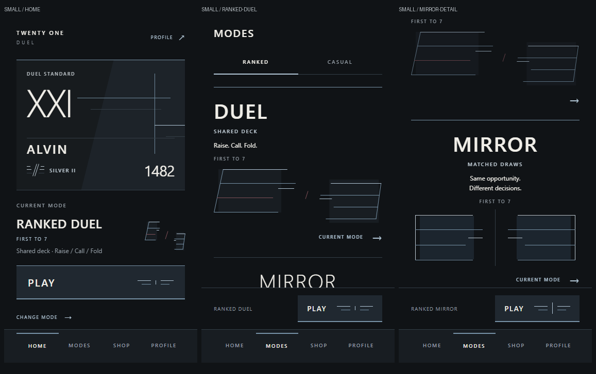
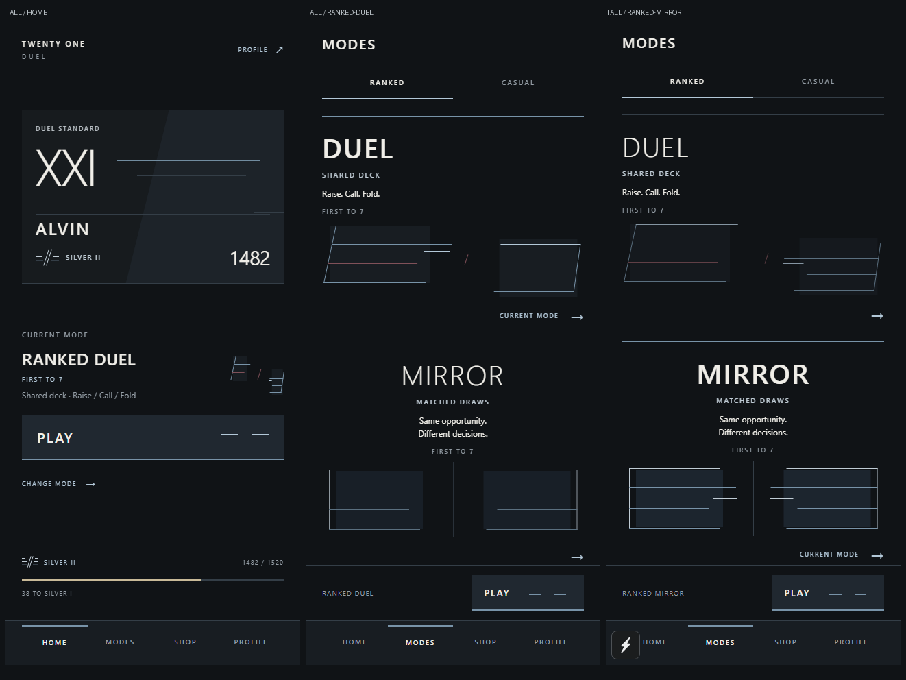

# Lobby and mode art direction ? first pass

Focused on Home, Modes and Player Card/rank identity. The existing palette and product architecture are preserved. No packages, game rules, navigation, mode structure or social behavior changed. Shop and Profile layouts have no additional changes; shared Player Card previews and compact matchup cards inherit the identity object.

## Composition

- **Home:** the equipped identity object leads; selected mode has its own opposing structure; Play is the dominant interaction; rank progression closes the lobby. The mode section is an open composition rather than a boxed dashboard section.
- **Player Card:** oversized XXI, equipped cosmetic linework, an offset charcoal field, player name, provisional rank mark and rating form one continuous object. Compact matchups use the same composition and cosmetic configuration.
- **Modes:** open ruled sections replace generic bordered option cards. Duel has asymmetric, sloped confronting structures with a small oxblood interruption. Mirror has equal opposing structures and a central axis, with centered typography. Artwork occupies meaningful space; active selection uses weight, rule contrast, resolved artwork opacity and the explicit CURRENT MODE label.
- **Rank:** reusable code-drawn split strokes and progression layers sit beside existing division labels. The three local Roman-numeral subdivisions affect filled layers only; no ranking logic changed.
- **Play:** opposing strokes converge on press, with restrained surface compression. Existing haptics, duplicate-launch guard and entry flows remain intact. There are no idle loops or additional animation clocks. Geometry and interaction marks have separate parts for future motion.

## Screenshots

Small (375 ? 667): Home, Duel selection and the scrolled Mirror section.

Tall (430 ? 932): Home and both ranked selections.

Individual Ranked/Casual, progression, press-state, cosmetic-variant and compact-matchup captures are in [art-direction](art-direction/). On the small viewport, progression and the second mode remain available through the existing scroll surfaces. Both modes fit together on the tall viewport.

These are actual app screenshots from Chromium using iPhone viewport dimensions, not an iOS simulator or device render. The review used reduced motion and recorded zero browser page errors.

## Verification

- TypeScript: passed.
- Expo ESLint: passed.
- All 224 tests: passed, zero failures, using `node --test --test-isolation=none tests/*.test.cjs` because Windows restricts isolated test subprocesses in this workspace.
- iOS Hermes export: passed; 1,537 modules, 3.6 MB HBC bundle in `.expo/art-direction-ios`.
- Browser: checked both viewport sizes, all four mode/category combinations, scrolled progression and Mirror selection, Play press/entry/cancel, all three equipped identity variants, and compact friend matchup rendering through existing controls.
- Component review: decorative geometry is hidden from assistive technology; division labels and selected states retain explicit text; no per-frame state, new dependencies or navigation ownership were added.

## Source files changed

- `src/screens/HomeScreen.tsx`
- `src/screens/ModesScreen.tsx`
- `src/components/PlayerCard.tsx`
- `src/components/ModeGeometry.tsx`
- `src/components/RankMark.tsx`
- `src/components/MatchEntryMark.tsx`
