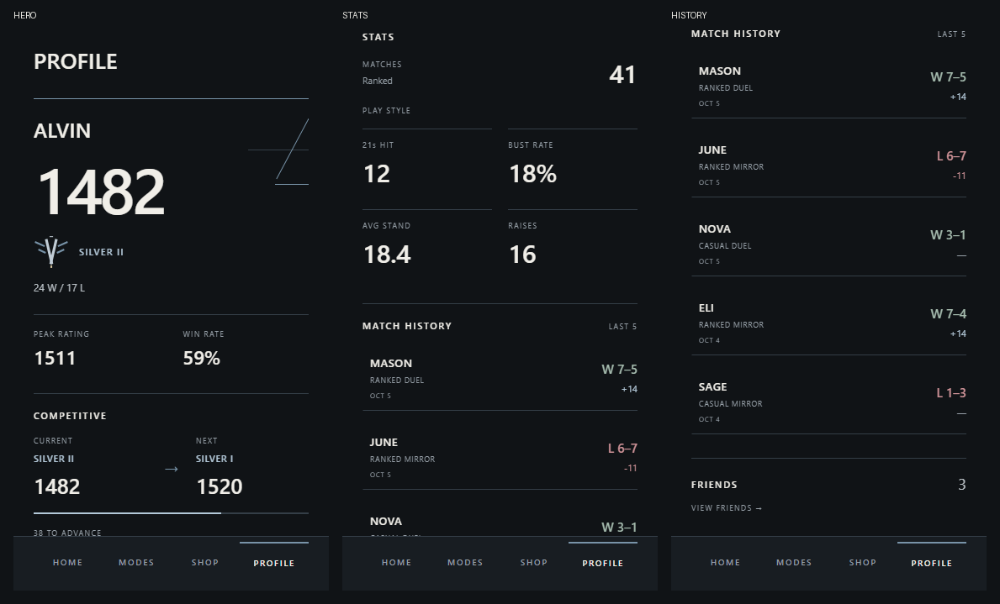
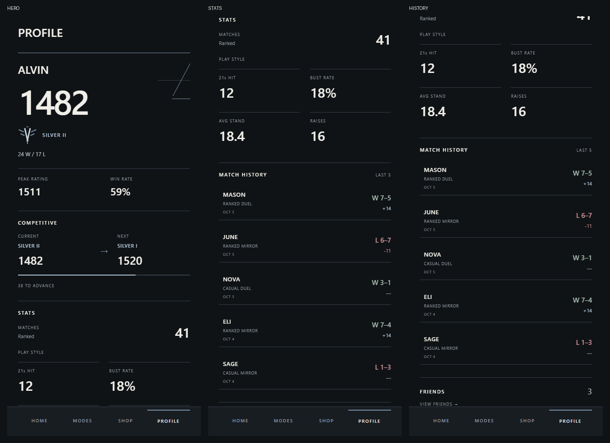

# Competitive Profile direction

Profile now uses the approved Home/Modes language as a competitive player record. This pass changes only `src/screens/ProfileScreen.tsx`, plus this report and `docs/profile-direction/*.png`. Earlier uncommitted work is preserved on `visual-direction`.

## Review screenshots

Captures are actual app renders at 375 × 667 and 430 × 932 browser viewports. They are not native iOS device renders. Each sheet includes separate scroll positions so the full Profile can be reviewed. The seeded history has no retained reviews, so these rows correctly have no review affordance.

## Changes

- Hero: open canvas, partial angular linework and stronger name/rating hierarchy. The existing Silver II emblem sits alongside the division, followed by W/L, peak rating and win rate. No filled enclosing hero card.
- Competitive: compact CURRENT and NEXT groups, directional arrow, steel progress line and remaining points. Rating calculations, thresholds and accessibility values are unchanged.
- Stats: two open columns with thin separators and stronger values. The four filled rectangles are removed. Ranked match count and existing play-style values remain unchanged.
- Match History: open rows with thin separators, opponent, mode, score/result, rating delta and a compact date derived from the existing timestamp. Losses and negative deltas use the existing muted oxblood token. Wins use the existing muted victory token.
- Match Review: retained rows remain entirely tappable, with a thin active edge, small arrow and two-pixel press movement. Rows without retained data have no arrow or action. No separate Review button, prompts, counts or fabricated reviews.
- Friends: lightweight final entry with count and VIEW FRIENDS arrow. Existing callback and behavior are preserved.

## Scope

The five sections remain hero, Competitive, Stats, Match History and Friends. Loadout remains removed. Shop, Friends screens, gameplay, PostMatch and Match Review are unchanged by this visual pass. Cosmetic state, stats/history data, retention and navigation architecture are unchanged. The existing bottom navigation provides the same Profile active state as the competitive shell. No dependencies or colors were added.

## Validation

- TypeScript passed.
- Expo ESLint passed.
- All **225 tests passed**, including exact retained-review navigation, unavailable-row behavior, review access isolation, hidden-information protection and five-review retention.
- iOS Hermes production export passed: 1,539 modules, 3.6 MB bundle.
- Browser screenshots and Friends navigation passed at both viewport sizes with zero page errors.
- `git diff --check` passed.

The composition now reads as a player record through the rating, rank and recent results, with less dashboard framing. Native-device visual review remains outstanding. Changes remain local and uncommitted for review before the next screen.
