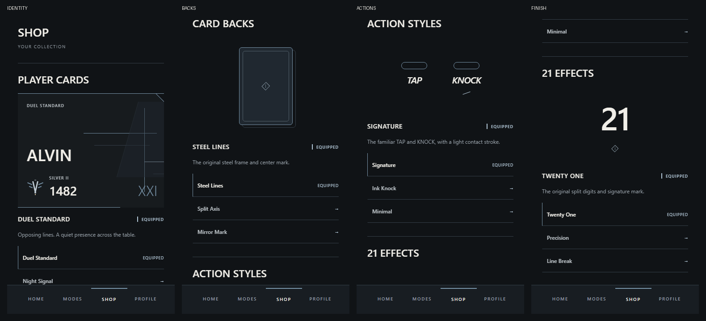
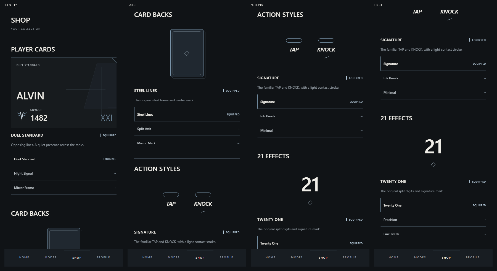

# Competitive collection direction

Shop now extends the approved visual language into collection and customization. This pass is local and uncommitted on `visual-direction`.

## Screenshots

Variant previews: [Night Signal](shop-direction/shop-direction-tall-night-preview.png) and [Mirror Frame](shop-direction/shop-direction-tall-mirror-preview.png).

These are actual app captures at 375 × 667 and 430 × 932 browser viewports, with separate scroll positions for each category. Native iOS visual review remains outstanding. The separate preview screen keeps its existing full-screen navigation and Back action.

## Presentation

- Header: SHOP has the same stronger hierarchy as the competitive shell, supported by YOUR COLLECTION.
- Player Cards: the largest object preview combines player name, rating and the existing Silver II emblem with partial framing. Duel Standard uses opposing geometry; Night Signal uses offset horizontal signals; Mirror Frame uses equal frames and a central axis. Existing catalog geometry and backgrounds are retained.
- Card Backs: a centered vertical deck object uses the actual CardBackArtwork renderer. An offset outline adds subtle physical depth without an enclosing category panel. Steel Lines, Split Axis and Mirror Mark retain their original distinct marks and axes.
- Action Styles: a compact TAP/KNOCK moment uses the actual ActionLettering primitive and existing contact/stroke configuration. Minimal retains physical contact without lettering. This is a static composition, not an animation playground.
- 21 Effects: the existing TwentyOneEffect renderer runs with the previewed cosmetic supplied through a local CosmeticProvider. Its existing one-shot digit motion and reduced-motion behavior are preserved; a persistent catalog mark identifies the signature after settling. No loops, particles or new effects.
- Equipped state: compact EQUIPPED metadata and a thin steel edge. Alternatives are lightweight rows beneath the object, separated by fine rules.

## Selection behavior

Tapping a row opens the existing selection screen with that candidate, large preview, name, description and EQUIP action. Candidate changes do not equip. Explicit Equip still calls the existing handler and light haptic. Equipped candidates display a disabled EQUIPPED action. Back returns to Shop. The detail screen now uses matching collection styling and a clipped accent-edge action.

## Scope and files

- `src/screens/ShopScreen.tsx`
- `src/screens/CosmeticSelector.tsx`
- `src/components/CollectionPreview.tsx` (new, collection-only presentation)
- `tests/ui-contract.test.cjs` (existing equip assertion trims whitespace introduced by the decorative cut)
- This report and `docs/shop-direction/*.png`

Catalog, loadout state, ownership, equip handlers, persistence, backend and gameplay remain unchanged. Default CosmeticPreview, PlayerCard and gameplay renderers are unchanged by this pass. Friends, matchmaking, PostMatch and Match Review are unchanged. Bottom navigation keeps its existing Shop active state and architecture. No colors or dependencies were added.

## Validation

- TypeScript passed.
- Expo ESLint passed.
- All **225 tests passed**.
- iOS Hermes production export passed: 1,539 modules, 3.6 MB bundle.
- Browser captures and preview/equip checks passed at both phone sizes with zero page errors. Previewing Night Signal left Duel Standard equipped; explicitly equipping Mirror Frame updated Shop and Home.
- `git diff --check` passed.

React review: stable catalog keys, derived equipped state, unchanged local selection state, accessible preview/equip controls and disabled state, no new subscriptions or animation loops. Existing effect cleanup remains in its gameplay renderer.
